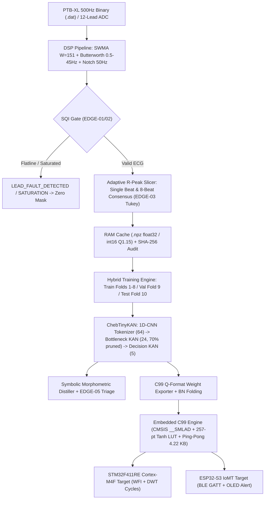
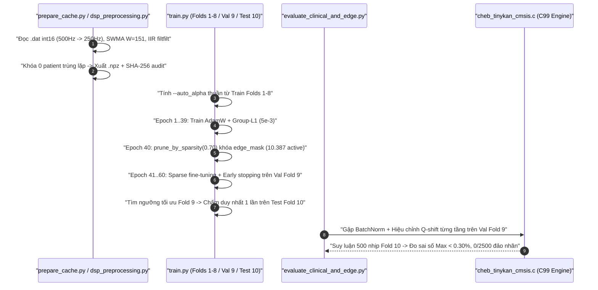

# 📘 PROJECT DEEP-DIVE & ARCHITECTURE CODEBOOK

- **Project:** Cheb-TinyKAN — Clinically Explainable Ultra-Lightweight Orthogonal Polynomial KAN for Edge Microcontrollers
- **Author:** Deep Explainer & Codebase Architect (`/explain`)
- **Scope:** Full Codebase (`FULL_PROJECT`: DSP $\to$ PyTorch Hybrid Training $\to$ Symbolic Distillation $\to$ Bare-Metal C99/STM32F411/ESP32-S3)
- **Date:** 2026-11-11
- **Target Audience:** CEO (Lab Trưởng), Tech Lead, Embedded & ML Engineers

---

## 📑 Mục Lục Tra Cứu Nhanh
1. [Tầng 1: Kiến Trúc Tổng Thể & Mô Hình Tư Duy](#tầng-1-kiến-trúc-tổng-thể--mô-hình-tư-duy)
2. [Tầng 2: Cây Thư Mục & Bản Đồ Phân Vai Trách Nhiệm](#tầng-2-cây-thư-mục--bản-đồ-phân-vai-trách-nhiệm)
3. [Tầng 3: Luồng Dữ Liệu & Thực Thi Xuyên Suốt](#tầng-3-luồng-dữ-liệu--thực-thi-xuyên-suốt)
4. [Tầng 4: Giải Phẫu Chi Tiết Từng File & Hàm Then Chốt](#tầng-4-giải-phẫu-chi-tiết-từng-file--hàm-then-chốt)
5. [Cẩm Nang Vận Hành & Gỡ Lỗi Nhanh (Troubleshooting Runbook)](#cẩm-nang-vận-hành--gỡ-lỗi-nhanh)

---

## 🏛️ Tầng 1: Kiến Trúc Tổng Thể & Mô Hình Tư Duy

### 1.1 Triết Lý Thiết Kế (Design Philosophy)
Mã nguồn Cheb-TinyKAN tuân theo kiến trúc **Hybrid Pipeline-Decoupled TinyML**, tách biệt cứng thành 4 ranh giới chức năng bất biến:
1. **Deterministic DSP & Cache Isolation (Tiền xử lý tất định, không rò rỉ):** Mọi lọc nhiễu SWMA/Butterworth/SQI và cắt nhịp sóng R chỉ chạy một lần duy nhất rồi đóng băng bằng SHA-256 theo giao thức Inter-patient 10-Fold của PTB-XL, cho phép vừa chạy lặp 60 epochs trên CPU local trong ~3 phút, vừa bảo đảm tính tái lập tuyệt đối.
2. **Orthogonal Bounded KAN Core (Mạng đa thức bị chặn biên):** Thay vì B-spline của KAN cổ điển (đòi hỏi tra bảng lưới động tốn RAM), tầng Bottleneck ($64 \to 24$) và Decision ($24 \to 5$) dùng đa thức Chebyshev loại 1 bậc $4$ trên $[-1, 1]$ với phép truy hồi 3 phần tử ($T_{k+1} = 2xT_k - T_{k-1}$). Nhờ bất đẳng thức $|T_k(x)| \le 1$, cả gradient lúc huấn luyện lẫn thanh ghi `int16_t` trên MCU đều không bị tràn số.
3. **Immutable Autograd & Group-L1 Edge Masking:** Các hàm truy hồi `forward_torch` không cập nhật tensor in-place nhằm giữ sạch đồ thị đạo hàm ngược, còn việc cắt tỉa 70% cạnh KAN được khóa cứng bằng buffer `edge_mask` trước khi sparse fine-tune 20 epoch cuối.
4. **Zero-Allocation Symmetric Q-Format Runtime:** Động cơ C99 phía thiết bị nhúng không sử dụng `malloc`/`free`, không dựa hoàn toàn vào float32 ở tầng ẩn, tái sử dụng đúng 2 mảng `static int16_t` Ping-Pong (`4,320 bytes` / mảng) và nạp hằng số trọng số gập BatchNorm directly vào `const` Flash.

### 1.2 Sơ Đồ Khối Kiến Trúc Toàn Hệ Thống


---

## 📂 Tầng 2: Cây Thư Mục & Bản Đồ Phân Vai Trách Nhiệm

```text
exe/topic1/
├── data/
│   ├── dsp_preprocessing.py       # SWMA, IIR Notch/Bandpass, SQI, Slicer 1 nhịp & đa nhịp
│   ├── scp_mapping.py             # Ánh xạ SCP-ECG sang 5 nhãn giải phẫu (NORM, AMI, IMI, LMI, SMI)
│   ├── easi_dower.py              # Ma trận Dower 12x3 & đánh giá suy hao vùng ST (AC-09)
│   ├── ptbxl_dataset.py           # Loader PTB-XL nhị phân & RAM Cache đơn nhịp / đa nhịp Q1.15
│   └── sample/                    # 1 bản ghi ECG thật (~124 KB) đảm bảo test không skip khi clone
├── losses/
│   └── focal_loss.py              # MultiLabelFocalLoss hỗ trợ scalar alpha & vector auto_alpha
├── models/
│   ├── cheb_kan.py                # ChebyshevPolynomial, ChebyshevKANLayer, Group-L1 & edge_mask
│   ├── model.py                   # Conv1DTokenizer, TemporalZoneConv1DTokenizer & ChebTinyKAN
│   ├── baselines.py               # MLPTinyBaseline, ResNet1DBaseline, InceptionTime1D (đối chứng)
│   ├── quantization.py            # Q15Quantizer, KANEdgePruner & CHeaderExporter nền tảng
│   └── symbolic_distillation.py   # Ma trận M (Chebyshev -> Monomial), Alert & EDGE-05 Triage
├── firmware/
│   ├── cheb_tinykan_cmsis.h       # Interface C99, ARM __SMLAD inline asm, structs calibrated & EDGE-05
│   ├── cheb_tinykan_cmsis.c       # Inference Q1.15/Calibrated, Ping-Pong RAM, 257-pt LUT, Multi-beat
│   ├── cheb_tinykan_weights_run2.h# Bảng trọng số thực tế Run #2 gập BN đóng băng trong Flash
│   ├── test_firmware.c            # Bộ kiểm thử C99 độc lập (ASan/UBSan & -O3 -Werror)
│   └── targets/
│       ├── stm32f411/             # Bare-metal Cortex-M4F target, linker 512K/128K, DWT cycle audit
│       └── esp32s3/               # ESP-IDF BLE GATT + OLED clinical showcase component
├── scripts/
│   ├── prepare_cache.py           # Sinh cache đơn nhịp float32 + docs/cache_audit.json
│   ├── prepare_multibeat_cache.py # Sinh cache đa nhịp Q1.15 + docs/multibeat_cache_audit.json
│   ├── evaluate_clinical_and_edge.py # Audit tự động AC-06..09 (Symbolic, C99 500 nhịp, EASI)
│   ├── evaluate_multibeat_consensus.py # Thẩm định tổng hợp 10s đa nhịp trên Fold 9 -> Fold 10
│   ├── train_baselines.py         # Đo benchmark tốc độ / accuracy các baseline IEEE
│   ├── export_c_weights.py        # Xuất bảng trọng số Run #2 sang cheb_tinykan_weights_run2.h
│   └── train_colab.sh             # Script tự động chạy tác vụ nặng trên Colab GPU T4
├── train.py                       # Pipeline huấn luyện chuẩn hóa (Folds 1-8 / 9 / 10, --auto_alpha)
├── test_local.py                  # Hệ thống unit/integration test toàn diện tại local
└── docs/                          # Toàn bộ nhật ký, audit JSON, DeepDive & Integrity Log
```

---

## 🔄 Tầng 3: Luồng Dữ Liệu & Thực Thi Xuyên Suốt

### 3.1 Luồng Huấn Luyện Chuẩn Hóa, Cắt Tỉa & Đóng Băng Kiểm Định (`AC-01`, `AC-03`, `AC-08`)


### 3.2 Luồng Phòng Vệ & Đồng Thuận Đa Nhịp Trên Thiết Bị Nhúng (`EDGE-01..05`)
1. Mỗi cửa sổ 180 mẫu Q1.15 đi qua `cheb_verify_sqi_q15` để **chặn bão hòa rail (`EDGE-02`, `>5%` mẫu vượt ngưỡng `±32000`) trước khi bắt tuột điện cực (`EDGE-01`, biên độ `<80 LSB`)**. Điều này tránh lỗi ngụy trang kẹt nguồn rail thành flatline mất điện cực.
2. Khi chạy trên dải ECG 10s, `AdaptiveRPeakBeatSlicer.extract_multibeat_windows` lấy tối đa 8 nhịp sóng R; nếu nhịp tim đo được vượt **150 bpm (`EDGE-03`)**, hàm tự động nhân cửa sổ suy giảm cosine từ mẫu 135 đến 180 (`+340ms..+520ms`) để triệt tiêu sóng P/T nhịp kế mà vẫn giữ nguyên vẹn QRS và đoạn ST.
3. Kết quả xác suất 5 nhánh (đơn nhịp hoặc trung bình cắt ngọn đa nhịp qua `cheb_multibeat_aggregate`) được phân luồng lâm sàng theo `EDGE-05`: `>65%` báo `CRITICAL_MI_ALERT`, trong dải `[45%, 65%]` chuyển sang `SUSPECTED_ISCHEMIA_MONITOR_TREND` (theo dõi 15 phút), và dưới `45%` giữ trạng thái theo dõi thường quy.

---

## 🔬 Tầng 4: Giải Phẫu Chi Tiết Từng File & Hàm Then Chốt

### 📄 4.1 Tiền Xử Lý & Nạp Dữ Liệu
- [`SWMAFilter.filter_multichannel`](file:///home/pd/hcmus_queue/lab_dientuysinh/project/exe/topic1/data/dsp_preprocessing.py#L40-L55): Vector hóa lọc đường đẳng điện 12 kênh bằng `uniform_filter1d(..., mode='nearest')`. *Design Rationale:* Tương đương toán học với vòng lặp Python (`max diff = 5.96e-08`) nhưng nhanh hơn hàng chục lần vì chạy vòng lặp trong nhân C của SciPy.
- [`AdaptiveRPeakBeatSlicer.extract_multibeat_windows`](file:///home/pd/hcmus_queue/lab_dientuysinh/project/exe/topic1/data/dsp_preprocessing.py#L180-L278): Dò tối đa `max_beats=8` đỉnh QRS trên năng lượng Lead II + V2 có chu kỳ trơ `0.30s` và áp dụng `EDGE-03` Tukey right-tail khi `hr_bpm > 150.0`.
- [`MultiBeatCachedPTBXLDataset`](file:///home/pd/hcmus_queue/lab_dientuysinh/project/exe/topic1/data/ptbxl_dataset.py#L137-L178): Lưu giữ bản chất Q1.15 dưới dạng mảng `int16` thay vì `float32`, cắt giảm **50% RAM tiêu thụ** (`~616 MB` nén cho 173.414 nhịp tim).

### 📄 4.2 Kiến Trúc Lõi Chebyshev KAN & Hàm Mất Mát
- [`ChebyshevPolynomial.forward_torch`](file:///home/pd/hcmus_queue/lab_dientuysinh/project/exe/topic1/models/cheb_kan.py#L53-L73): Sinh danh sách bất biến `T_list` rồi dùng `torch.stack(T_list, dim=-1)`. *Design Rationale:* Tránh lỗi `AsStrided version mismatch` của PyTorch Autograd khi gán đè từng lát cắt tensor.
- [`ChebyshevKANLayer`](file:///home/pd/hcmus_queue/lab_dientuysinh/project/exe/topic1/models/cheb_kan.py#L77-L225): Kết hợp `w_base * tanh(x) + sum(c_k * T_k(x))`, lưu `edge_mask` làm `register_buffer` để đảm bảo cả quá trình fine-tune hậu cắt tỉa (`prune_by_sparsity`) lẫn xuất trọng số sang C đều tắt tuyệt đối 70% cạnh thừa.
- [`TemporalZoneConv1DTokenizer`](file:///home/pd/hcmus_queue/lab_dientuysinh/project/exe/topic1/models/model.py#L103-L138) vs [`Conv1DTokenizer`](file:///home/pd/hcmus_queue/lab_dientuysinh/project/exe/topic1/models/model.py#L66-L100): Đối chứng khoa học giữa gộp toàn cục `AdaptiveAvgPool1d(1)` (`64` kênh, thắng toàn diện ở Run #2) và phân pha 4 vùng `Conv1d(48->16) + AdaptiveAvgPool1d(4)` (Run #3).
- [`MultiLabelFocalLoss`](file:///home/pd/hcmus_queue/lab_dientuysinh/project/exe/topic1/losses/focal_loss.py#L22-L73): Hỗ trợ broadcast cả scalar `alpha` lẫn vector per-class `--auto_alpha` lưu qua `register_buffer`.

### 📄 4.3 Giải Trình Ký Hiệu, Lượng Tử Hóa & Động Cơ C99 Nhúng
- [`SymbolicMorphometricDistiller`](file:///home/pd/hcmus_queue/lab_dientuysinh/project/exe/topic1/models/symbolic_distillation.py#L80-L190): Dùng ma trận `CHEBYSHEV_TO_CANONICAL_MATRIX_DEGREE_4` chuyển đổi chính xác hệ số $c_k \to a_k$ (`max_err = 1.19e-07`), đi kèm cảnh báo ST mV & phân luồng `classify_clinical_state` (`EDGE-05`).
- [`cheb_tinykan_cmsis.c`](file:///home/pd/hcmus_queue/lab_dientuysinh/project/exe/topic1/firmware/cheb_tinykan_cmsis.c#L543-L705):
  - **Ping-Pong Buffers (`#L23-L24`):** Chỉ dùng 2 mảng tĩnh `2160 x int16` (`4,320 bytes` active peak).
  - **257-Entry Linearly Interpolated Tanh LUT (`#L80-L126`):** Thay đa thức Taylor bậc 3 (chỉ đúng trên $[-1, 1]$) bằng bảng tra 257 điểm chuẩn xác trên $[-4, +4]$, giúp chuyển đổi $Q$-format đạt sai số xác suất tối đa `0,2952%` (`AC-08`).
  - **ARM Cortex-M4 Hardware `__SMLAD` ([`cheb_tinykan_cmsis.h#L98-L110`](file:///home/pd/hcmus_queue/lab_dientuysinh/project/exe/topic1/firmware/cheb_tinykan_cmsis.h#L98-L110)):** Tự động dùng `<arm_math.h>` khi có CMSIS pack, hoặc fallback trực tiếp sang hợp ngữ phần cứng `smlad` trên `arm-none-eabi-gcc -mcpu=cortex-m4`.
- [`targets/stm32f411/main_stm32f411.c`](file:///home/pd/hcmus_queue/lab_dientuysinh/project/exe/topic1/firmware/targets/stm32f411/main_stm32f411.c) & [`targets/esp32s3/main_esp32s3.c`](file:///home/pd/hcmus_queue/lab_dientuysinh/project/exe/topic1/firmware/targets/esp32s3/main_esp32s3.c): Hai điểm cuối đóng gói phần cứng thực tế sử dụng [`cheb_tinykan_weights_run2.h`](file:///home/pd/hcmus_queue/lab_dientuysinh/project/exe/topic1/firmware/cheb_tinykan_weights_run2.h).

---

## 🛠️ Cẩm Nang Vận Hành & Gỡ Lỗi Nhanh

| Hiện tượng / Triệu chứng | Nguyên nhân cốt lõi | Tệp & Vị trí cần kiểm tra | Cách khắc phục chuẩn |
| :--- | :--- | :--- | :--- |
| **Colab / Local chạy 1 epoch quá 250s** | Chưa bật cache `.npz`, `__getitem__` tính lại SWMA/IIR mọi epoch | [`data/ptbxl_dataset.py#L181`](file:///home/pd/hcmus_queue/lab_dientuysinh/project/exe/topic1/data/ptbxl_dataset.py#L181) | Chạy 1 lần `scripts/prepare_cache.py` rồi truyền `--cache_path` |
| **AUC > 0.92 nhưng F1 & Sens thấp (<50%)** | Dùng scalar `--alpha 0.25` ép lớp hiếm xuống dưới ngưỡng `0.50` | [`train.py#L142`](file:///home/pd/hcmus_queue/lab_dientuysinh/project/exe/topic1/train.py#L142) | Bật `--auto_alpha` (tính từ Fold 1–8) & calibrate trên Fold 9 |
| **Cảnh báo `0%` cạnh bị tỉa dù có L1** | Độ mạnh Group-L1 quá yếu nếu không ép ngưỡng theo phần trăm | [`models/cheb_kan.py#L173`](file:///home/pd/hcmus_queue/lab_dientuysinh/project/exe/topic1/models/cheb_kan.py#L173) | Dùng `--l1_lambda 5e-3 --prune_epoch 40 --target_sparsity 0.70` |
| **Sai lệch xác suất C99 vs PyTorch > 1.5%** | Quên gập BatchNorm hoặc sai `out_len` Stage 3 (`22` vs `23`) / `tanh` saturation | [`cheb_tinykan_cmsis.c#L601`](file:///home/pd/hcmus_queue/lab_dientuysinh/project/exe/topic1/firmware/cheb_tinykan_cmsis.c#L601) | Gọi `cheb_tinykan_infer_calibrated` với bảng từ `export_c_weights.py` |
| **Tín hiệu kẹt áp rail trả về `LEAD_FAULT`** | Kiểm tra flatline `max-min < 80` đặt trước đếm rail saturation | [`cheb_tinykan_cmsis.c#L149`](file:///home/pd/hcmus_queue/lab_dientuysinh/project/exe/topic1/firmware/cheb_tinykan_cmsis.c#L149) | Kiểm tra saturation `EDGE-02` trước flatline `EDGE-01` |
| **Build Cortex-M4 báo thiếu `<arm_math.h>`** | Biên dịch bare-metal chưa gắn CMSIS-DSP pack | [`cheb_tinykan_cmsis.h#L98`](file:///home/pd/hcmus_queue/lab_dientuysinh/project/exe/topic1/firmware/cheb_tinykan_cmsis.h#L98) | Đã vá `__has_include(<arm_math.h>)` + inline `smlad` thuần C99 |
